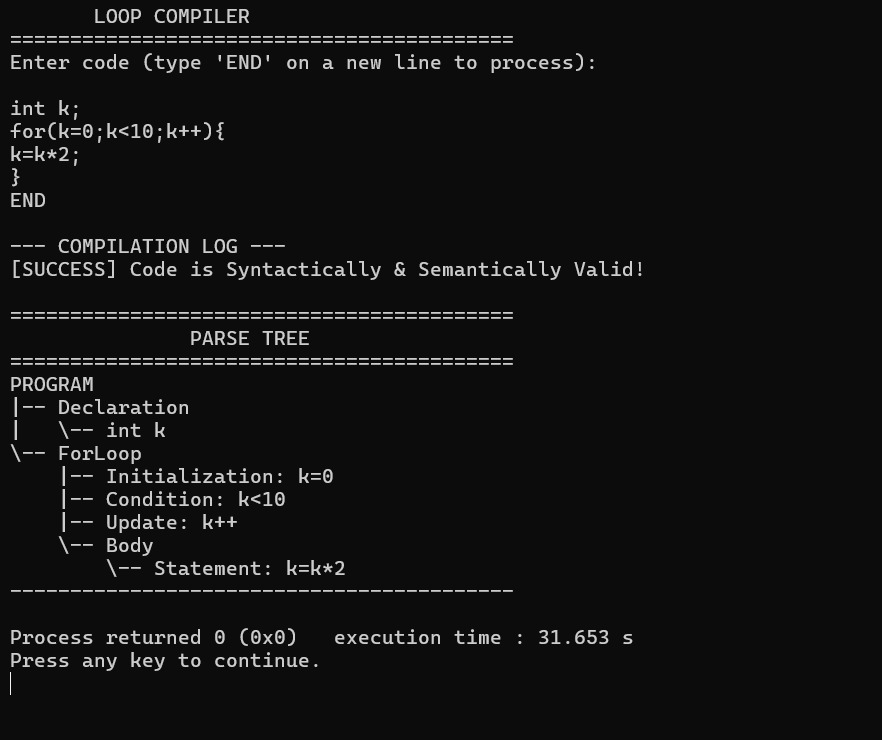
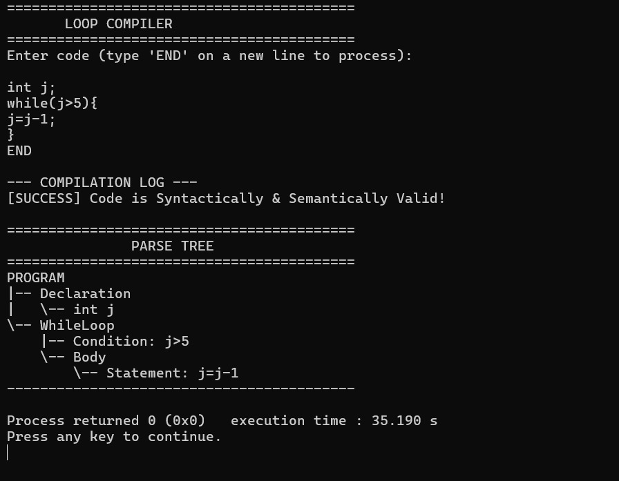
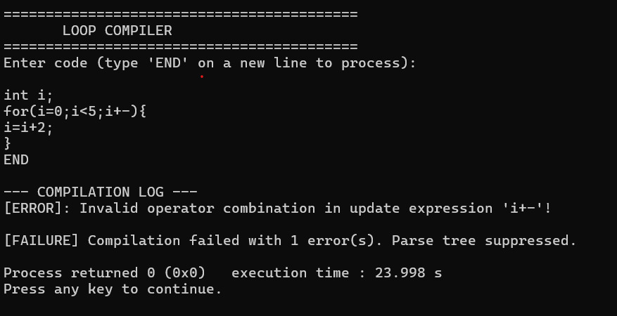
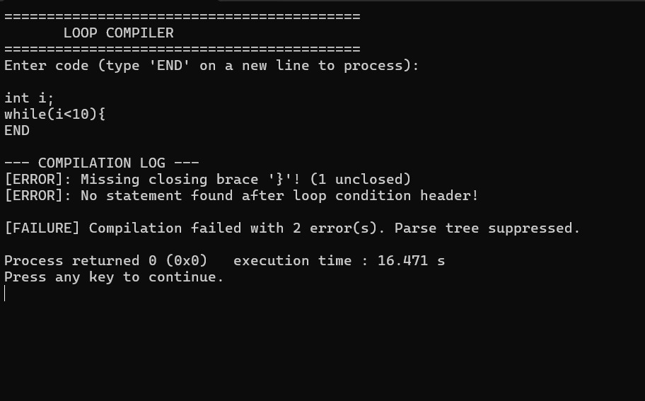

# Loop Statement Compiler

> An educational compiler front end for analyzing C-like `for`, `while`, and `do-while` loop constructs, with a modern web interface for entering source code and viewing compilation results.


---

## Problem Statement

> "Develop a compiler front end for for, while, and do-while loops. Validate initialization, conditions, increment/decrement expressions, and loop-body syntax."

---

## Project Overview

**Loop Statement Compiler** is a mini compiler / compiler front-end project developed for the **Compiler Design** course. It analyzes C-like source code containing `for`, `while`, and `do-while` loop structures, performing:

1. **Lexical Analysis (Tokenization):** Identifies keywords, identifiers, numeric literals, string literals, operators, delimiters, and preprocessor directives.
2. **Syntax Validation:** Validates loop syntax — parentheses, condition expressions, semicolons, and compound block nesting (brace matching).
3. **Semantic Checks:** Detects undeclared variable usage and invalid operator combinations in expressions.
4. **Parse-Tree-Style Output:** Generates and displays a hierarchical tree representation of declarations, loop headers (initialization, condition, update), and loop body statements.
5. **Error Reporting:** Reports syntax errors, semantic errors, and structural issues with descriptive messages.
6. **Web Interface:** Provides a browser-based code editor for entering source code, selecting example programs, compiling, and viewing tokens, parse tree output, and error diagnostics.

---

## Objectives

- Perform lexical analysis and identify tokens (keywords, identifiers, numbers, operators, delimiters).
- Validate supported `for`, `while`, and `do-while` loop syntax.
- Check initialization, conditions, and increment/decrement expressions in `for` loop headers.
- Perform basic semantic checks (e.g., undeclared variable detection).
- Detect syntax and structural errors (missing semicolons, unmatched braces, incomplete expressions).
- Display parse-tree-style output showing the hierarchical structure of loop constructs.
- Provide a web interface for entering source code and viewing compilation results.

---

## Technologies Used

| Technology | Purpose |
|---|---|
| **C (C99)** | Native compiler source code — lexer, validator, parse tree generator |
| **Python 3** | Flask backend server and compiler adapter layer |
| **Flask** | Web framework for REST API and static file serving |
| **HTML5** | Web application interface structure |
| **CSS3** | Responsive styling with dark/light theme support |
| **JavaScript (ES6+)** | Frontend logic — code editor, tab management, API integration |
| **Git / GitHub** | Version control and project repository |

---

## Features

- **Code Editor:** Browser-based editor with line numbers, cursor position tracking, and tab indentation.
- **Compile Button:** Sends source code to the Flask backend for compilation and analysis.
- **Token Output:** Displays all identified tokens in a structured table with type, lexeme, line, and column.
- **Parse-Tree-Style Output:** Shows hierarchical tree representation of program structure including loop constructs.
- **Error Diagnostics:** Reports syntax and semantic errors with descriptive messages.
- **Example Programs:** Built-in example programs (7 examples) covering valid loops and common errors, selectable from a dropdown.
- **Status Indicator:** Shows whether the application is using the real C compiler binary or demo mode.
- **Dark / Light Theme:** Toggle between dark and light UI themes.
- **Real Compiler / Demo Mode:** Automatically uses the native C compiler binary when available; falls back to a clearly labeled demo mode (Python-based simulation) when the binary is not built.

---

## Project Structure

```
Loop-Statement-Compiler/
├── app.py                          # Flask web server with REST API endpoints
├── compiler_adapter.py             # Adapter layer: subprocess runner, output parser, demo fallback
├── index.html                      # Single-page web application interface
├── style.css                       # CSS styling (dark/light themes, responsive layout)
├── script.js                       # Frontend JavaScript (editor, API calls, output rendering)
├── requirements.txt                # Python dependencies (Flask)
├── RUN_LOOP_COMPILER.bat           # Windows launcher — installs deps, opens browser, starts server
├── .gitignore                      # Git ignore rules
├── README.md                       # Project documentation
│
├── compiler/                       # C compiler source and build scripts
│   ├── compiler.c                  # Enhanced C loop compiler (lexer + validator + parse tree)
│   ├── loop_compiler_original.c    # Original standalone C compiler (Member 1)
│   ├── build.bat                   # Windows build script (clang / gcc / cl)
│   └── build.sh                    # Linux/macOS build script
│
├── examples/                       # Built-in example C programs
│   ├── for_loop.c                  # Valid for-loop
│   ├── while_loop.c                # Valid while-loop
│   ├── do_while_loop.c             # Valid do-while loop
│   ├── nested_loops.c              # Nested for + while loops
│   ├── missing_semicolon.c         # Error: missing semicolon
│   ├── mismatched_braces.c         # Error: unclosed brace
│   └── invalid_condition.c         # Error: malformed loop condition
│
├── tests/                          # Automated test suite
│   ├── test_backend.py             # 15 unit tests for adapter + Flask API
│   └── run_tests.bat               # Quick test runner
│
└── docs/                           # Project documentation and reports
    ├── reports/
    │   ├── Project_Report.pdf      # Final project report
    │   ├── Project_Report.docx     # Final project report (editable)
    │   └── Project_Report_Phase1.docx  # Phase 1 report
    └── screenshots/
        ├── compiler_error_detection.jpeg    # Error detection screenshot
        ├── compiler_brace_error.jpeg        # Brace error screenshot
        ├── compiler_for_loop_success.jpeg   # Successful for-loop parse tree
        └── compiler_while_loop_success.jpeg # Successful while-loop parse tree
```

---

## Prerequisites

- **Python 3.8+** with `pip`
- **Web Browser** (Chrome, Firefox, Edge, etc.)
- **C Compiler** *(optional — needed only for Real Compiler Mode)*:
  - Windows: GCC (MinGW-w64), Clang, or MSVC `cl`
  - Linux/macOS: `gcc` or `clang`

> **Note:** If no C compiler is available, the application runs in **Demo Mode** with a Python-based simulated analyzer. The demo mode is clearly labeled and provides the same interface experience for testing and evaluation.

---

## Installation and Execution

### Windows (Recommended — One-Click Launch)

1. **Navigate** to the project folder.
2. **Double-click** `RUN_LOOP_COMPILER.bat`.
   - It automatically detects Python, installs Flask if needed, and opens the browser.

### Manual Setup

1. **Clone the repository:**
   ```bash
   git clone https://github.com/karthikrajj/Loop-Statement-Compiler.git
   cd Loop-Statement-Compiler
   ```

2. **Install Python dependencies:**
   ```bash
   pip install -r requirements.txt
   ```

3. **(Optional) Build the native C compiler:**
   ```bash
   cd compiler
   # On Windows with GCC:
   gcc -std=c99 -Wall -O2 compiler.c -o compiler.exe
   # Or run the provided script:
   build.bat
   cd ..
   ```

4. **Start the Flask server:**
   ```bash
   python app.py
   ```

5. **Open in browser:**
   ```
   http://127.0.0.1:5000
   ```

6. **Check the mode indicator** in the header:
   - 🟢 **Real C Compiler** — native binary detected and active.
   - 🟡 **Demo Mode (Simulated)** — running Python-based simulation.

---

## Usage

1. **Enter or select a loop program:**
   - Type C source code directly in the code editor, or
   - Select a built-in example from the **Examples** dropdown (e.g., "Valid 'for' Loop", "Error: Missing Semicolon").

2. **Click the Compile button.**

3. **Inspect the results:**
   - **Tokens Tab:** View all lexical tokens identified (keyword, identifier, number, operator, delimiter) with line and column numbers.
   - **Tree Tab:** View the parse-tree-style output showing the hierarchical structure of declarations, loop headers (initialization, condition, update), and body statements.
   - **Errors Tab:** View any syntax errors, semantic errors, or warnings with descriptive messages.
   - **Raw Log Tab:** View the raw stdout/stderr output from the compiler.

4. **Test with different inputs:**
   - Try valid `for`, `while`, and `do-while` loops to see successful parse trees.
   - Try removing semicolons, mismatching braces, or writing incomplete conditions to see error detection.

---

## Grammar and Compiler Design

### Context-Free Grammar (CFG)

The compiler validates loop constructs based on the following simplified grammar productions:

```
Program         → StatementList
StatementList   → Statement StatementList | ε
Statement       → Declaration | ForLoop | WhileLoop | DoWhileLoop | ExprStmt

Declaration     → Type Identifier ';'
Type            → 'int' | 'float' | 'char' | 'double'

ForLoop         → 'for' '(' Init ';' Condition ';' Update ')' '{' StatementList '}'
WhileLoop       → 'while' '(' Condition ')' '{' StatementList '}'
DoWhileLoop     → 'do' '{' StatementList '}' 'while' '(' Condition ')' ';'

Init            → Declaration | Assignment | ε
Condition       → Expression RelOp Expression | Expression
Update          → Expression IncDecOp | Assignment

Expression      → Identifier | Number | Expression Op Expression
RelOp           → '<' | '>' | '<=' | '>=' | '==' | '!='
IncDecOp        → '++' | '--'
```

> **Note:** This is a documented CFG representing the intended grammar. The handwritten C compiler (`compiler/compiler.c`) implements parsing logic that validates these constructs through procedural code rather than a formal parser generator. It is a parse-tree-style representation, not a formal abstract syntax tree (AST).

### Where to Find Grammar Documentation

- **CFG and production rules** are described in this README and in the project reports located in [`docs/reports/`](docs/reports/).
- **Diagrams and visual CFG representations** may be included in the project report PDF.

---

## Testing

### Automated Test Suite

The project includes 15 automated unit tests covering:

| # | Test | Status |
|---|------|--------|
| 1 | Compiler executable status detection | ✅ Pass |
| 2 | Empty source code validation | ✅ Pass |
| 3 | Oversized source code validation (64KB limit) | ✅ Pass |
| 4 | Valid `for` loop compilation | ✅ Pass |
| 5 | Valid `while` loop compilation | ✅ Pass |
| 6 | Valid `do-while` loop compilation | ✅ Pass |
| 7 | Nested loops compilation | ✅ Pass |
| 8 | Missing semicolon error detection | ✅ Pass |
| 9 | Mismatched braces error detection | ✅ Pass |
| 10 | Invalid condition error detection | ✅ Pass |
| 11 | Demo mode fallback | ✅ Pass |
| 12 | GET `/api/status` endpoint | ✅ Pass |
| 13 | GET `/api/examples` endpoint | ✅ Pass |
| 14 | POST `/compile` with valid code | ✅ Pass |
| 15 | POST `/compile` with empty code | ✅ Pass |

### Run Tests

```bash
python -m unittest tests.test_backend -v
```

**Output:**
```
Ran 15 tests in 0.593s

OK
```

### Example Test Cases

**Valid `for` loop** (`examples/for_loop.c`):
```c
#include <stdio.h>
int main() {
    int sum = 0;
    for (int i = 0; i < 10; i++) {
        sum += i;
        printf("i = %d, sum = %d\n", i, sum);
    }
    return 0;
}
```
**Expected:** Compilation succeeds. Tokens include `KEYWORD: for`, `IDENTIFIER: i`, etc. Parse tree shows `ForLoop` with Initialization, Condition, and Update nodes.

**Valid `while` loop** (`examples/while_loop.c`):
```c
#include <stdio.h>
int main() {
    int i = 0;
    while (i < 5) {
        printf("Count: %d\n", i);
        i++;
    }
    return 0;
}
```
**Expected:** Compilation succeeds. Parse tree shows `WhileLoop` with Condition node.

**Valid `do-while` loop** (`examples/do_while_loop.c`):
```c
#include <stdio.h>
int main() {
    int counter = 1;
    do {
        printf("Iteration: %d\n", counter);
        counter *= 2;
    } while (counter <= 32);
    return 0;
}
```
**Expected:** Compilation succeeds. Parse tree shows `Do-WhileLoop` with Condition node.

**Missing semicolon** (`examples/missing_semicolon.c`):
```c
int main() {
    int i = 0      // <-- Missing semicolon here
    while (i < 5) { ... }
}
```
**Expected:** Error reported: missing `;` after variable declaration.

**Mismatched braces** (`examples/mismatched_braces.c`):
```c
for (i = 0; i < 5; i++) {
    printf("%d\n", i);
// Missing closing brace
```
**Expected:** Error reported: unclosed `{` brace.

---

## Screenshots

### Successful For Loop Compilation with Parse Tree


### Successful While Loop Compilation with Parse Tree


### Error Detection — Invalid Operator Combination


### Error Detection — Mismatched Braces


---

## Limitations

- **Not a complete C compiler.** This is a compiler front end focused only on loop constructs (`for`, `while`, `do-while`). It does not support the full C language grammar.
- **No code generation.** The compiler performs lexical analysis, syntax validation, and semantic checks, but does not generate intermediate code, assembly, or machine code.
- **Parse-tree-style output.** The tree output is a formatted textual representation of the program structure. It is not a formal abstract syntax tree (AST) data structure with in-memory nodes and pointers.
- **Limited semantic analysis.** Semantic checks include undeclared variable detection and basic expression validation, but do not cover type checking, scope analysis, or full C-standard conformance.
- **Simplified tokenizer.** The lexer handles common C constructs but may not correctly tokenize all edge cases (e.g., multi-line macros, complex escape sequences).
- **Single-file programs.** The compiler processes single source code inputs and does not support multi-file compilation or `#include` file resolution.

---

## Team Members and Contributions

| Member | Name | Responsibility | Contribution |
|---|---|---|---|
| Member 1 | Maria Rose Johny | C Source Code | Develop the compiler in C, including lexical analysis, syntax validation for `for`, `while`, and `do-while` loops, AST-style output, basic semantic checks, and error handling. |
| Member 2 | Jithu Joseph | Application Interface | Design the application interface with a code editor, Compile button, and output sections for tokens, AST, and errors. Integrate the interface with the C compiler and test the application. |
| Member 3 | Irene Tessa Seban | Project Report — Part 1 | Prepare the abstract, introduction, problem statement, objectives, system architecture, CFG for all three loops, grammar production rules, and grammar transformations. |
| Member 4 | Daniya Dennis | Project Report — Part 2 | Prepare lexical and syntax analysis sections, AST explanation, semantic checks, test cases with expected outputs, screenshots, results, limitations, and conclusion. Combine both parts into the complete report. |
| Member 5 | Karthik Raj | PPT — Part 1 and GitHub | Prepare the first half of the presentation covering the introduction, objectives, problem statement, system architecture, CFG, and grammar transformations. Create the GitHub repository and upload the initial source code and grammar files. |
| Member 6 | Kevin Kanniyakonil Biju | PPT — Part 2, Demo and GitHub | Prepare the second half of the presentation covering implementation, AST, semantic checks, test results, and conclusion. Coordinate the live demo, prepare `README.md`, and verify that all project files are uploaded to GitHub. |

---

## License

This project was developed as an academic assignment for the Compiler Design course and is intended for educational purposes.
